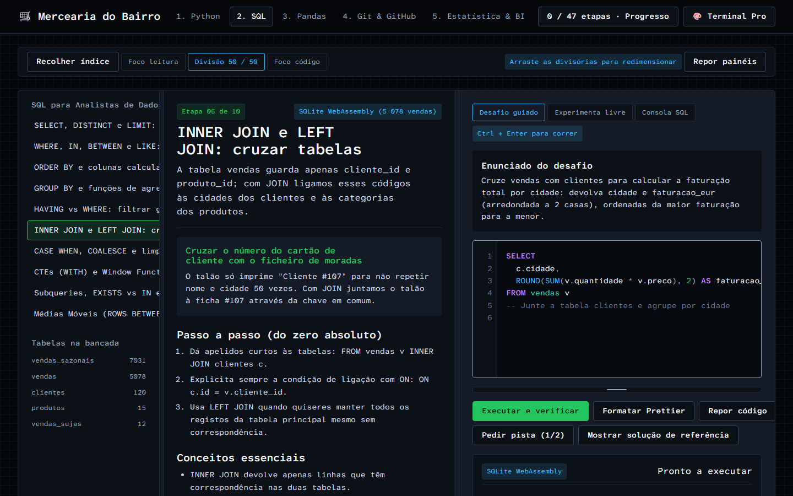
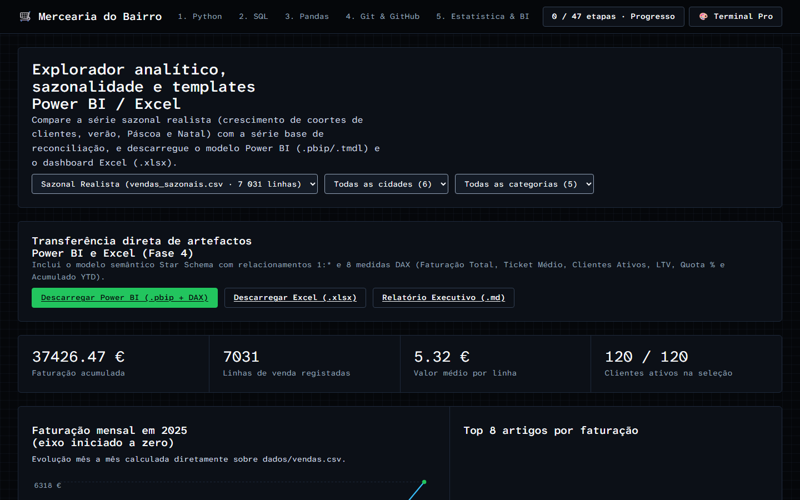
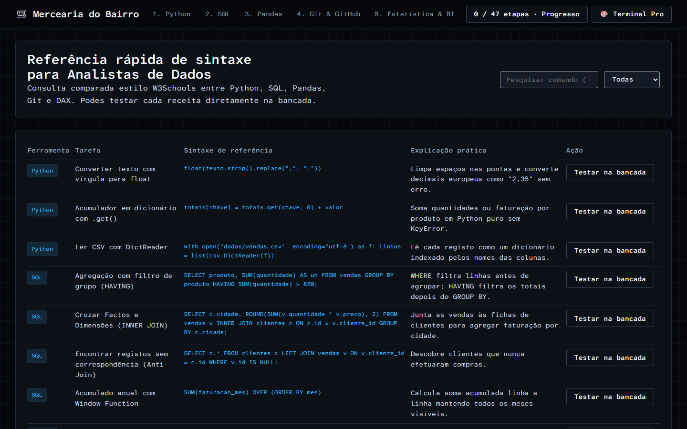
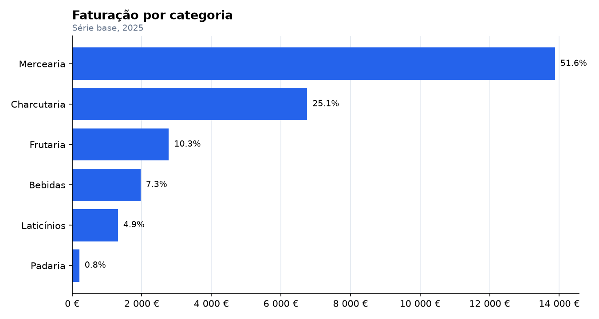
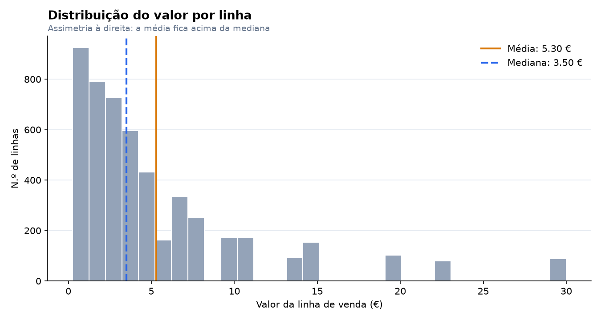

# Mercearia do Bairro

Projeto de aprendizagem de dados: uma mercearia fictícia usada para aprender
Python, SQL, pandas, Git/GitHub e Estatística/BI do zero, e acabar com um portfólio que mostra o percurso completo.

> **Academia Interativa na Vercel (Produção):** [https://web-one-nu-34.vercel.app](https://web-one-nu-34.vercel.app)

[](https://github.com/GustakunPT/Course_DA/actions/workflows/ci.yml)



| Explorador CSV e downloads Power BI/Excel | Referência rápida de sintaxe |
| --- | --- |
|  |  |

## Academia Web Interativa (`web/`)

A pasta `web/` contém a plataforma interativa completa estilo **W3Schools**, com tema **Hallmark Console** (modo escuro Grafite e modo claro Papel) e editor com realce de sintaxe **VS Code Dark+ / Light+** e formatador **Prettier** (`Shift + Alt + F`):

- **6 Trilhas de Analista de Dados (47 etapas do Zero Absoluto ao Nível Profissional):**
  1. **Python do Zero Absoluto à Caixa Registadora** (inclui Etapa 00 de Pensamento Computacional + Pyodide Python 3.12 WebAssembly)
  2. **SQL para Analistas de Dados** (SQLite WebAssembly sobre as 5 078 vendas reais)
  3. **Pandas e Oficina de Limpeza** (`vendas.csv` e `vendas_sujas.csv` no browser)
  4. **Git, GitHub e Portfólio** (Simulador interativo de terminal Git)
  5. **Estatística Descritiva, Excel/DAX e Power BI** (Média vs Mediana, IQR/Outliers, Curva ABC, Star Schema)
  6. **Prática Profissional: ETL, Testes de Dados, Coortes e Entrevista Técnica** (Arquitetura Medalhão Bronze/Silver/Gold, Data Contracts/Testes de Qualidade, Retenção/Coortes/LTV, Performance SQL & Índices, Desafio Clássico de Entrevista `RANK`/`LAG` e Caso Executivo 360º)
- **Painéis 100% Redimensionáveis na Página:** divisórias verticais e horizontais arrastáveis (índice lateral, lição vs editor e altura do editor vs consola), modos rápidos (*Recolher índice*, *Foco leitura*, *Divisão 50/50*, *Foco código* e *Repor painéis*) com memória no navegador.
- **Explorador Analítico CSV & Auditoria de Qualidade** (`26 902,89 €` em 5 078 vendas, filtros por cidade e categoria e diagnóstico de `vendas_sujas.csv`).
- **Referência Rápida W3** com pesquisa instantânea e botão *Testar na bancada*.

```bash
cd web
npm install
npm run dev      # servidor local em http://localhost:4173
npm run build    # sincroniza CSVs + WASM e gera build de produção em web/dist
git push         # publica na Vercel (deploy automático a partir do ramo main)
```

## O que é este projeto

Os dados são inventados (gerados por `src/gerar_dados.py`), por isso podem ser
publicados sem problemas de privacidade. Cada fase do plano acrescenta uma camada:

| Fase | O que acrescenta | Onde |
| --- | --- | --- |
| 0 | Estrutura de pastas, Git, GitHub | `/` |
| 1 | Gerador de dados e Caixa Registadora em Python puro | `src/` |
| 2 | Base de dados PostgreSQL e perguntas de negócio em SQL | `sql/` |
| 3 | Limpeza e análise em pandas | `cadernos/` |
| 4 | Estatística, gráficos e dashboard Power BI | `relatorios/` |
| 5 | Verificações de qualidade e relatório automático | `src/`, `relatorios/` |

## Como correr

Precisa do [Python 3](https://www.python.org/downloads/) instalado.

```bash
# 1. gerar os dados fictícios (cria 4 ficheiros CSV em dados/)
python src/gerar_dados.py

# 2. (Fase 1) verificar os exercícios das lições
python verificar.py        # todas as semanas
python verificar.py 3      # só a semana 3

# 3. (Fase 1, semanas 11 e 12) quando tiver escrito a Caixa Registadora
python src/caixa.py

# 4. (Fase 2) base SQLite normalizada para correr sql/02_perguntas_negocio.sql
python src/carregar_base.py   # cria mercearia.db

# 5. (Fase 4) gráficos de estatística em relatorios/graficos/
pip install -r requirements.txt
python src/graficos.py
```

## Gráficos (Fase 4)

`python src/graficos.py` lê os CSV com pandas e desenha com matplotlib:

| Faturação mensal (sazonal vs base) | Curva ABC dos produtos |
| --- | --- |
|  |  |
| **Faturação por categoria** | **Distribuição do valor por linha** |
|  |  |

## Testes

Cada `git push` corre os testes no GitHub Actions (ver o selo CI acima). Para os correr localmente:

```bash
pip install -r requirements-dev.txt
pytest tests                       # Python: gerador, auditoria e gráficos
cd web && npm test                 # Web: motores, API de sync e as 47 etapas
```

Os testes da web confirmam que a solução oficial de cada desafio (Python, pandas, SQL e Git) passa
na própria correção automática e que o código inicial ainda não passa. Os desafios Python correm no
mesmo Pyodide 0.26.4 do browser (pacote npm `pyodide`); na primeira vez descarregam o pandas, por isso
precisam de internet.

## Cadernos de pandas (Academia Interativa, etapas 13 a 16)

A trilha 3 da app já corre pandas no browser. Para prática mais longa, use os cadernos da pasta `cadernos/`:

```bash
pip install -r requirements.txt  # uma só vez
jupyter notebook                 # abra o ficheiro da pasta cadernos/
```

No VS Code, basta abrir o ficheiro `.ipynb`. Cada caderno tem 16 tarefas em quatro níveis (aquecimento, treino,
desafio e chefe final) sobre as 5 078 vendas de `dados/vendas.csv`. A última célula diz quantas estão certas, sem
mostrar as respostas. Se a pasta `dados/` estiver vazia, corra primeiro `python src/gerar_dados.py`.

| Caderno | Tema |
| --- | --- |
| `etapa13_pandas_dataframes.ipynb` | DataFrames, colunas, contas e contagens |
| `etapa14_pandas_filtros.ipynb` | Filtrar, ordenar e trabalhar com texto |
| `etapa15_pandas_groupby_merge.ipynb` | Agrupar (`groupby`) e juntar tabelas (`merge`) |
| `etapa16_pandas_limpeza.ipynb` | Limpar dados: vazios, duplicados, texto, números e datas (usa `dados/vendas_sujas.csv`) |

## Como estudar cada semana

1. Leia a lição em `licoes/` (começa pela analogia).
2. Faça a secção "Experimente partir": errar de propósito é a forma mais rápida de perceber.
3. Complete o ficheiro correspondente em `exercicios/`.
4. Corra `python verificar.py N` até estar tudo certo.
5. Faça um commit com uma mensagem clara.

## Estrutura

```
mercearia-do-bairro/
├── dados/         # CSVs gerados (produtos, clientes, vendas)
├── licoes/        # lições com analogias (semanas 1-2 a 12)
├── exercicios/    # exercícios para completar
├── verificar.py   # verificador automático dos exercícios
├── src/           # scripts Python (gerador, auditoria, gráficos)
├── tests/         # testes pytest
├── sql/           # queries SQL
├── cadernos/      # cadernos Jupyter da Academia (pandas)
├── relatorios/    # gráficos, dashboards, apresentações
├── web/           # Academia interativa (Vite + TypeScript, deploy na Vercel)
├── docs/img/      # capturas de ecrã do README
├── .gitignore
├── requirements.txt
├── requirements-dev.txt
└── README.md
```

## Dados

- `produtos.csv`: id, nome, categoria, preco (15 artigos)
- `clientes.csv`: id, nome, cidade (120 clientes em 6 cidades)
- `vendas.csv`: base uniforme de reconciliação (5 078 vendas, `26 902,89 €`)
- `vendas_sazonais.csv`: série com sazonalidade e tendências reais de negócio (7 031 vendas, `37 426,47 €` — crescimento mensal de coortes de clientes de 53 para 112 ativos, pico de verão em bebidas/fruta, Páscoa, Natal, efeito dia de salário e fim de semana)
- `vendas_sujas.csv`: lote com anomalias para oficina de limpeza (Etapa 16)

## Relatórios, Excel e Power BI (`relatorios/`)

Ao correr `python src/auditoria_dados.py`, são gerados automaticamente na pasta `relatorios/` (e disponibilizados para download direto no separador **Explorador CSV** da aplicação web):
- `relatorios/relatorio_executivo_2025.md`: relatório executivo comparando a série sazonal e a série base.
- `relatorios/Dashboard_Mercearia_do_Bairro_2025.xlsx`: livro Excel multi-folha (`Resumo_KPIs`, `Sazonalidade_Mensal`, `Curva_ABC_Produtos`, `Analise_Cidades` e `Medidas_DAX_PowerBI`).
- `relatorios/powerbi/MerceariaDoBairro.pbip` e `relatorios/PowerBI_Mercearia_do_Bairro_PBIP.zip`: projeto Power BI Desktop com modelo semântico Star Schema (`model.bim` e pasta `definition/*.tmdl`), relacionamentos `1:*` e 8 medidas DAX prontas.
