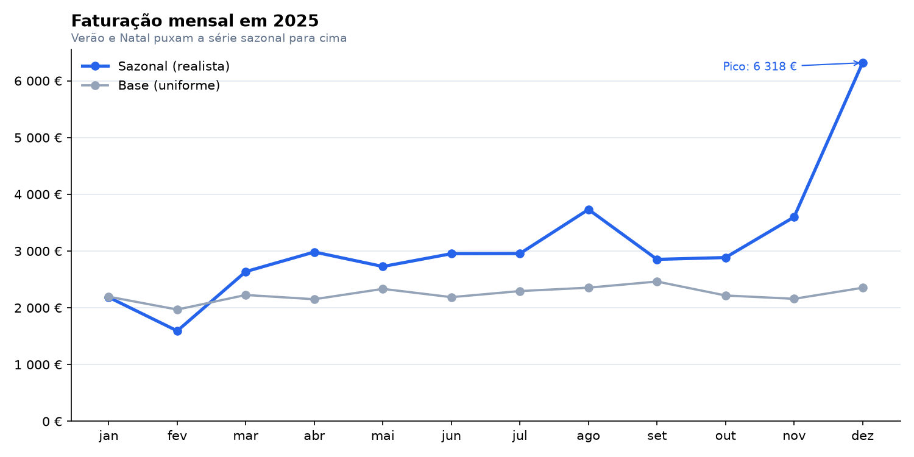
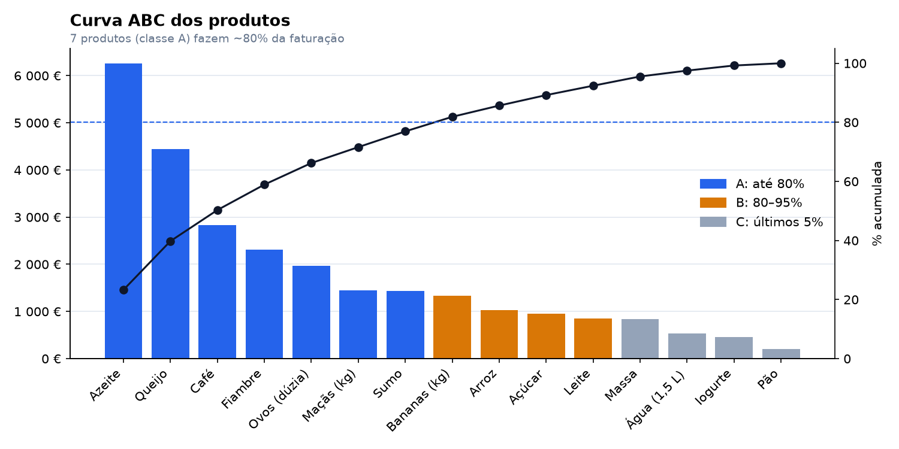

# Mercearia do Bairro

Projeto de aprendizagem de dados: uma mercearia fictícia usada para aprender
Python, SQL, pandas, Git/GitHub e Estatística/BI do zero, e acabar com um portfólio que mostra o percurso completo.

> **Academia Interativa na Vercel (Produção):** [https://web-one-nu-34.vercel.app](https://web-one-nu-34.vercel.app)

[](https://github.com/GustakunPT/Course_DA/actions/workflows/ci.yml)


| Explorador CSV e downloads Power BI/Excel | Referência rápida de sintaxe |
| --- | --- |
|  |  |

## Academia Web Interativa (`web/`)

A pasta `web/` contém a plataforma interativa completa estilo **W3Schools**, com tema **Hallmark Console** (modo escuro Grafite e modo claro Papel) e editor com realce de sintaxe **VS Code Dark+ / Light+** e formatador **Prettier** (`Shift + Alt + F`):

- **8 Trilhas de Analista de Dados (80 etapas do Zero Absoluto ao projeto final próprio):**
  1. **Python do Zero Absoluto à Caixa Registadora** (inclui a etapa 01 de Pensamento Computacional + Pyodide Python 3.14 WebAssembly; as etapas 02 a 10 têm 2 exercícios de treino extra cada, uma explicação longa e um exemplo de erro típico com a mensagem do Python, a etapa 11 é uma revisão geral de todos os conceitos e a 12 é o projeto da Caixa Registadora)
  2. **SQL para Analistas de Dados** (SQLite WebAssembly sobre as 5 078 vendas reais; 2 treinos e 3 perguntas de quiz por etapa, a etapa 10 treina a matriz RFM e a 11 é uma revisão geral: o relatório por cidade)
  3. **Pandas e Oficina de Limpeza** (`vendas.csv` e `vendas_sujas.csv` no browser; 2 treinos e 3 perguntas de quiz por etapa, uma etapa 08 com NumPy, `pd.crosstab`, quantis e datas, as ferramentas que a trilha de Estatística usa, e a 09 é uma revisão geral: faturação por categoria e trimestre)
  4. **Git, GitHub e Portefólio** (simulador interativo de terminal Git, com 2 treinos por etapa)
  5. **Visualização, Excel/DAX e Power BI** (Curva ABC, relatório executivo, gráficos matplotlib desenhados no browser, Star Schema, DAX, prática guiada de Excel e Power BI com folha de respostas corrigida na app e inteligência de tempo: acumulado do ano, mês anterior e média móvel em DAX, Excel e pandas)
  6. **Estatística para Analistas** (média vs mediana, IQR/outliers, probabilidade condicional e Bayes, paradoxo de Simpson, correlação, intervalos de confiança, simulação e bootstrap com histogramas, teste de permutação, testes A/B de médias e de proporções, tamanho de amostra, qui-quadrado e ANOVA, regressão linear simples e múltipla, séries temporais (tendência, sazonalidade semanal e previsão simples) e perguntas rápidas de entrevista; cada etapa tem um desafio curto e treinos para as partes seguintes)
  7. **Prática Profissional: ETL, Testes de Dados, Coortes e Entrevista Técnica** (arquitetura medalhão bronze/silver/gold, testes de qualidade de dados, retenção, coortes e LTV, SQL mais rápido com índices, perguntas clássicas de entrevista com `RANK` e `LAG`, caso final para a direção, RGPD na prática (pseudonimização, minimização e grupos pequenos), Projeto Final guiado: SQL + pandas + gráfico + recomendação, e o README de portefólio gerado a partir dos dados)
  8. **Projeto final: os teus dados, a tua pergunta, o teu portefólio** (a etapa 01 é uma limpeza a sério, corrigida no browser, de 20 300 viagens de bicicletas partilhadas com 2 treinos e 3 perguntas de quiz; a 02 prepara o computador (Python, VS Code, Jupyter e Git); as etapas 03 a 06 são o teu próprio projeto com dados públicos portugueses, feito no teu computador e publicado no GitHub: escolher a pergunta e os dados, explorar e limpar, analisar e recomendar, e publicar; as etapas 07 a 09 preparam a procura de emprego: um portefólio com 3 a 4 projetos, o CV e o LinkedIn, e a leitura de anúncios com a entrevista. A app mostra o que entregar, uma lista para marcar e uma grelha de autoavaliação, mas não corrige este trabalho: as etapas concluídas aparecem como "Feito por ti, não corrigido")
- **Painéis 100% Redimensionáveis na Página:** divisórias verticais e horizontais arrastáveis (índice lateral, lição vs editor e altura do editor vs consola), modos rápidos (*Recolher índice*, *Foco leitura*, *Divisão 50/50*, *Foco código* e *Repor painéis*) com memória no navegador.
- **Explorador Analítico CSV & Auditoria de Qualidade** (`26 902,89 €` em 5 078 vendas, filtros por cidade e categoria e diagnóstico de `vendas_sujas.csv`).
- **Referência Rápida W3** com pesquisa instantânea e botão *Testar na bancada*.
- **Ecrã de escrita no telemóvel:** no telemóvel e no tablet na vertical, escrever código abre um ecrã próprio com Enunciado, Código e Resultado, para o teclado não desarrumar a lição. Quem preferir pode voltar ao editor normal.

```bash
cd web
npm install
npm run dev      # servidor local em http://localhost:4173
npm run build    # sincroniza CSVs + WASM e gera build de produção em web/dist
git push         # publica na Vercel (deploy automático a partir do ramo main)
```

## O que é este projeto

Os dados são inventados (gerados por `src/gerar_dados.py`), por isso podem ser
publicados sem problemas de privacidade. Cada fase do plano acrescenta uma camada:

| Fase | O que acrescenta | Onde |
| --- | --- | --- |
| 0 | Estrutura de pastas, Git, GitHub | `/` |
| 1 | Gerador de dados e Caixa Registadora em Python puro | `src/` |
| 2 | Base de dados PostgreSQL e perguntas de negócio em SQL | `sql/` |
| 3 | Limpeza e análise em pandas | `cadernos/` |
| 4 | Estatística, gráficos e dashboard Power BI | `relatorios/` |
| 5 | Verificações de qualidade e relatório automático | `src/`, `relatorios/` |

## Como correr

Precisa do [Python 3](https://www.python.org/downloads/) instalado.

```bash
# 1. gerar os dados fictícios (cria 4 ficheiros CSV em dados/)
python src/gerar_dados.py

# 2. (Fase 1) verificar os exercícios das lições
python verificar.py        # todas as semanas
python verificar.py 3      # só a semana 3

# 3. (Fase 1, semanas 11 e 12) quando tiver escrito a Caixa Registadora
python src/caixa.py

# 4. (Fase 2) base SQLite normalizada para correr sql/02_perguntas_negocio.sql
python src/carregar_base.py   # cria mercearia.db

# 5. (Fase 4) gráficos de estatística em relatorios/graficos/
pip install -r requirements.txt
python src/graficos.py
```

## Gráficos (Fase 4)

`python src/graficos.py` lê os CSV com pandas e desenha com matplotlib:

| Faturação mensal (sazonal vs base) | Curva ABC dos produtos |
| --- | --- |
|  |  |
| **Faturação por categoria** | **Distribuição do valor por linha** |
|  |  |

## Testes

Cada `git push` corre os testes no GitHub Actions (ver o selo CI acima). Para os correr localmente:

```bash
pip install -r requirements-dev.txt
pytest tests                       # Python: gerador, auditoria e gráficos
ruff check . && ruff format --check . && mypy   # Python: estilo, formatação e tipos
cd web && npm test                 # Web: motores, API de sync e as 80 etapas e os treinos
npm run typecheck && npm run lint && npm run format:check   # Web: tipos, ESLint e Prettier
npm run test:coverage              # Web: testes com mínimo de cobertura
```

Como as peças encaixam (Python, SQL, app web, workers e API): ver [docs/ARQUITETURA.md](docs/ARQUITETURA.md).

Os testes da web confirmam que a solução oficial de cada desafio (Python, pandas, SQL e Git) passa
na própria correção automática e que o código inicial ainda não passa. Os desafios Python correm no
mesmo Pyodide do browser (pacote npm `pyodide`); na primeira vez descarregam o pandas, por isso
precisam de internet.

## Cadernos de pandas (um por tema da trilha Pandas da Academia)

A trilha 3 da app já corre pandas no browser. Para prática mais longa, usa os cadernos da pasta `cadernos/`:

```bash
pip install -r requirements.txt  # uma só vez
jupyter notebook                 # abre o ficheiro da pasta cadernos/
```

No VS Code, basta abrir o ficheiro `.ipynb`. Cada caderno tem 16 tarefas em quatro níveis (aquecimento, treino,
desafio e chefe final) sobre as 5 078 vendas de `dados/vendas.csv`. A última célula diz quantas estão certas, sem
mostrar as respostas. Se a pasta `dados/` estiver vazia, corre primeiro `python src/gerar_dados.py`.

| Caderno | Tema |
| --- | --- |
| `pandas01_dataframes.ipynb` (etapa 01) | DataFrames, colunas, contas e contagens |
| `pandas02_filtros.ipynb` (etapas 02 a 04) | Filtrar, ordenar e trabalhar com texto |
| `pandas05_groupby_merge.ipynb` (etapa 05) | Agrupar (`groupby`) e juntar tabelas (`merge`) |
| `pandas06_limpeza.ipynb` (etapa 06) | Limpar dados: vazios, duplicados, texto, números e datas (usa `dados/vendas_sujas.csv`) |

## Como juntar o curso local e a app

O projeto tem dois percursos que se completam:

- **A app** (`web/`, publicada na Vercel) é o percurso principal: 80 etapas com desafios corrigidos e treinos, que acabam no teu próprio projeto, feito no teu computador e autoavaliado.
- **O curso local** (`licoes/`, `exercicios/` e `cadernos/`) dá mais leitura e prática no teu computador, com o
  VS Code, o terminal e o Git a sério.

Cada lição local começa com um link "Na app" para a etapa certa. A correspondência completa:

| Curso local | Exercício local | Na app |
| --- | --- | --- |
| `semana01_02_git_e_github.md` | (commits no teu repositório) | Git, etapas 01 a 05 |
| `semana03_variaveis_e_tipos.md` | `semana03_variaveis.py` | Python, etapas 02 e 03 |
| `semana04_texto_e_conversoes.md` | `semana04_conversoes.py` | Python, etapa 04 |
| `semana05_condicoes.md` | `semana05_condicoes.py` | Python, etapa 05 |
| `semana06_ciclo_for.md` | `semana06_ciclo_for.py` | Python, etapa 06 |
| `semana07_while_e_acumuladores.md` | `semana07_while.py` | Python, etapa 07 |
| `semana08_listas_e_colecoes.md` | `semana08_listas.py` | Python, etapa 08 |
| `semana09_dicionarios.md` | `semana09_dicionarios.py` | Python, etapa 09 |
| `semana10_funcoes.md` | `semana10_funcoes.py` | Python, etapa 10 |
| `semana11_ficheiros_e_csv.md` | `semana11_csv.py` | Python, etapas 11 (revisão) e 12 (Caixa Registadora) |
| `semana12_estatistica_e_bi.md` | `semana12_estatistica.py` | Estatística, etapas 01 e 02 |
| `cadernos/pandas01` a `pandas06` | (o próprio caderno) | Pandas, etapas 01 a 06 |
| `pratica_excel_powerbi.md` | (Excel e Power BI) | Visualização & BI, etapa 06 |

Depois da semana 12, o curso continua só na app: SQL, Pandas, Visualização & BI, Estatística e Nível Profissional.

### Como estudar cada tema

1. Faz a etapa na app: lê a analogia, resolve o desafio e pelo menos um treino.
2. Lê a lição em `licoes/` e faz a secção "Experimenta partir": errar de propósito é a forma mais rápida de perceber.
3. Completa o ficheiro correspondente em `exercicios/` e corre `python verificar.py N` até estar tudo certo.
4. Faz um commit com uma mensagem clara. Quem segue o curso local começa pelo Git (semanas 1 e 2); na app, a trilha
   Git pode ser feita em qualquer altura.

## Estrutura

```
mercearia-do-bairro/
├── dados/         # CSVs gerados (produtos, clientes, vendas)
├── licoes/        # lições com analogias (semanas 1-2 a 12) e guia de Excel e Power BI
├── exercicios/    # exercícios para completar
├── verificar.py   # verificador automático dos exercícios
├── src/           # scripts Python (gerador, auditoria, gráficos)
├── tests/         # testes pytest
├── sql/           # queries SQL
├── cadernos/      # cadernos Jupyter da Academia (pandas)
├── relatorios/    # gráficos, dashboards, apresentações
├── web/           # Academia interativa (Vite + TypeScript, deploy na Vercel)
├── docs/img/      # capturas de ecrã do README
├── .gitignore
├── requirements.txt
├── requirements-dev.txt
└── README.md
```

## Dados

- `produtos.csv`: id, nome, categoria, preco (15 artigos)
- `clientes.csv`: id, nome, cidade (120 clientes em 6 cidades)
- `vendas.csv`: base uniforme de reconciliação (5 078 vendas, `26 902,89 €`)
- `vendas_sazonais.csv`: série com sazonalidade e tendências reais de negócio (7 031 vendas, `37 426,47 €` — crescimento mensal de coortes de clientes de 53 para 112 ativos, pico de verão em bebidas/fruta, Páscoa, Natal, efeito dia de salário e fim de semana)
- `vendas_sujas.csv`: lote com anomalias para oficina de limpeza (etapa 06 da trilha Pandas)

## Relatórios, Excel e Power BI (`relatorios/`)

Ao correr `python src/auditoria_dados.py`, são gerados automaticamente na pasta `relatorios/` (e disponibilizados para download direto no separador **Explorador CSV** da aplicação web):
- `relatorios/relatorio_executivo_2025.md`: relatório executivo comparando a série sazonal e a série base.
- `relatorios/Dashboard_Mercearia_do_Bairro_2025.xlsx`: livro Excel multi-folha (`Resumo_KPIs`, `Sazonalidade_Mensal`, `Curva_ABC_Produtos`, `Analise_Cidades` e `Medidas_DAX_PowerBI`).
- `relatorios/powerbi/MerceariaDoBairro.pbip` e `relatorios/PowerBI_Mercearia_do_Bairro_PBIP.zip`: projeto Power BI Desktop com modelo semântico Star Schema (`model.bim` e pasta `definition/*.tmdl`), relacionamentos `1:*` e 8 medidas DAX prontas.

## Licença

O código está sob a licença [MIT](LICENSE). As lições e o restante conteúdo pedagógico estão sob
[CC BY 4.0](LICENSE-CONTEUDO.md): podes reutilizá-los desde que indiques a autoria.
