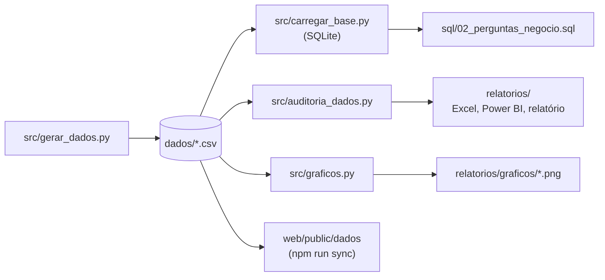
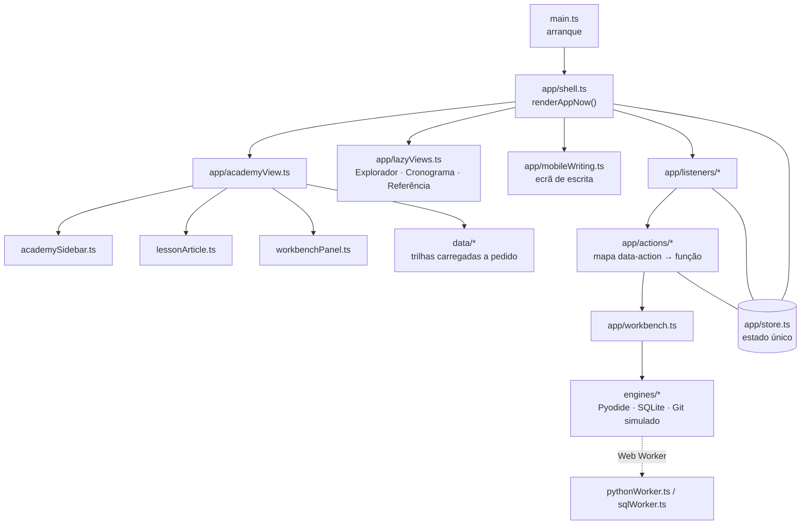

# Arquitetura

O repositório tem duas partes que partilham os mesmos dados fictícios da Mercearia:

| Parte | Pasta | O que é |
| --- | --- | --- |
| Projeto de dados | `src/`, `sql/`, `cadernos/`, `relatorios/` | Scripts Python, SQL e cadernos pandas que geram e analisam os dados. |
| Academia web | `web/` | Aplicação no browser (TypeScript + Vite) que ensina Python, SQL, pandas, Git, BI e Estatística com uma bancada de código. |

## Projeto de dados (Python)

- Os dados são gerados com semente fixa: correr `gerar_dados.py` volta a dar exatamente os mesmos CSV.
- Os testes (`tests/`, pytest) confirmam que os geradores são deterministas, que o SQL dá os
  números certos e que os gráficos são criados.
- Qualidade: `ruff check .`, `ruff format --check .` e `mypy` (configurados em `pyproject.toml`).

## Academia web (`web/`)

A app não usa framework: cada render gera o HTML da página inteira a partir de um estado único
e volta a ligar os eventos.

### O ciclo de um clique

1. O HTML tem atributos como `data-action="run-code"` ou `data-select-lesson="sql-02-where"`.
2. Depois de cada render, `app/listeners/index.ts` liga os eventos a esses elementos.
3. A ação altera o `state` (`app/store.ts`) e chama `renderApp()` (`app/rerender.ts`).
4. `renderApp()` chama `renderAppNow()` (`app/shell.ts`), que escreve o `#` do endereço, gera o
   HTML, volta ao passo 2 e repõe o foco do teclado.

`rerender.ts` existe para evitar dependências circulares: qualquer módulo pode pedir um render
sem importar `shell.ts`.

### Pastas de `web/src`

| Pasta | Conteúdo |
| --- | --- |
| `app/` | Orquestração da interface: estado, vistas, ações, eventos, URL, sincronização. |
| `app/actions/` | Um mapa `nome da ação → função`, dividido em interface, bancada e progresso. |
| `app/listeners/` | Restantes eventos (editor, navegação, lição, filtros, progresso). |
| `ui/` | Peças reutilizáveis e sem estado global: modais, editor com realce, gráficos, Gantt, temas. |
| `engines/` | Motores da bancada: Python (Pyodide) e SQL (sql.js) correm em Web Workers; Git é simulado. |
| `data/` | Trilhas, lições, quizzes e progresso. As trilhas são importadas só quando são abertas. |
| `styles/` | Tokens de design, base e estilos da app. |

### Acesso ao estado

Os módulos de `app/` importam o `state` de `app/store.ts` diretamente. Os módulos de `ui/` e
`engines/` não conhecem o estado global: recebem o que precisam por parâmetro (por exemplo
`createWorkbenchRunner(deps)` ou `renderGanttHtml(tracks, progress, opts)`), o que os torna
fáceis de testar isoladamente.

Esta regra é verificada pelo ESLint (`no-restricted-imports` em `web/eslint.config.js`): um
import de `app/` dentro de `ui/`, `engines/` ou `data/` faz o `npm run lint` falhar.

### Sincronização entre dispositivos

`api/sync.ts` é uma função da Vercel que guarda o progresso no Vercel Blob com um código
`MB-XXXX-XXXX-XXXX`. Valida e limita o tamanho de tudo o que recebe e tem um limite de pedidos
por IP. O progresso vive sempre primeiro no `localStorage`; a nuvem é opcional.

### Testes e qualidade

| Comando (em `web/`) | O que verifica |
| --- | --- |
| `npm run typecheck` | TypeScript estrito, sem variáveis nem parâmetros por usar. |
| `npm run lint` | ESLint com `typescript-eslint` (inclui promessas esquecidas). |
| `npm run format:check` | Formatação Prettier. |
| `npm test` | Vitest: motores, lições, quizzes, API e lógica de `app/`. |
| `npm run test:coverage` | O mesmo, com mínimo de cobertura. |
| `npm run test:e2e` | Smoke test no Chromium (Playwright) sobre o build de produção. |

Tudo isto corre no GitHub Actions (`.github/workflows/ci.yml`) em cada push e pull request.
