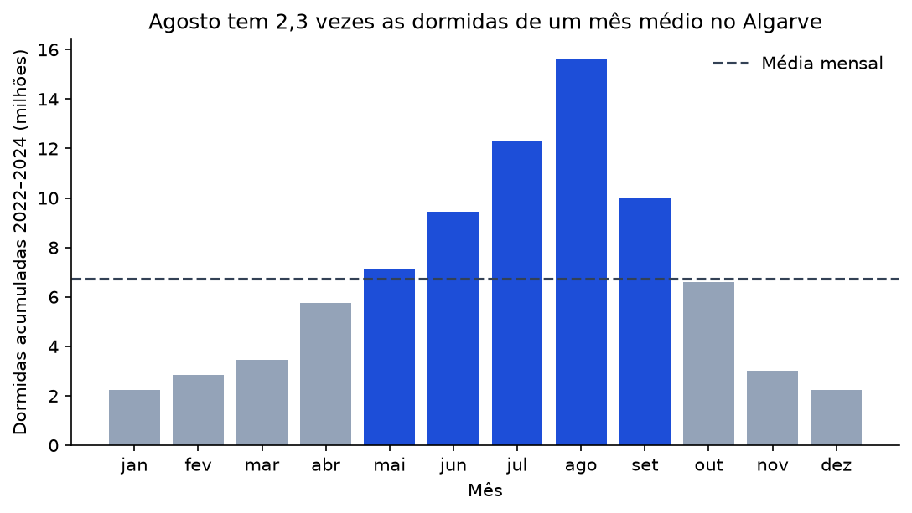

# Turismo no Algarve: em que meses reforçar o pessoal?

## Pergunta
Em que meses deve um alojamento do Algarve reforçar o pessoal?
Quem decide: o gestor de um alojamento local.

## Conclusões
- Agosto tem **2,3 vezes** as dormidas de um mês médio.
- Os meses acima da média são **maio, junho, julho, agosto, setembro**, concentrando **58,7%** das dormidas de junho a setembro (e **67,6%** de maio a setembro).
- **Recomendação:** reforçar a equipa entre maio e setembro, com pico de turnos em agosto.



## Dados
- Fonte: modelo baseado nos quadros mensais de dormidas por município do INE (`dados.gov.pt`), adaptado para treino.
- Descarregado a 17/11/2026. Licença: CC BY 4.0.
- 562 linhas após limpeza de 586 registos iniciais (saíram 10 duplicadas e 14 sem valor).

## Limites
Mostra quando há mais dormidas, não porquê nem qual a rentabilidade líquida por mês. Cobre o período 2022–2024.

## Como correr
```bash
pip install -r requirements.txt
jupyter notebook
```
Corre `cadernos/01_explorar_limpar.ipynb` e depois `cadernos/02_analise.ipynb`.

## Estrutura
- `dados/`: ficheiro bruto (`dormidas_algarve_bruto.csv`) e ficheiro limpo (`dormidas_algarve_limpo.csv`)
- `cadernos/`: exploração/limpeza e análise final
- `figuras/`: gráfico usado neste README
